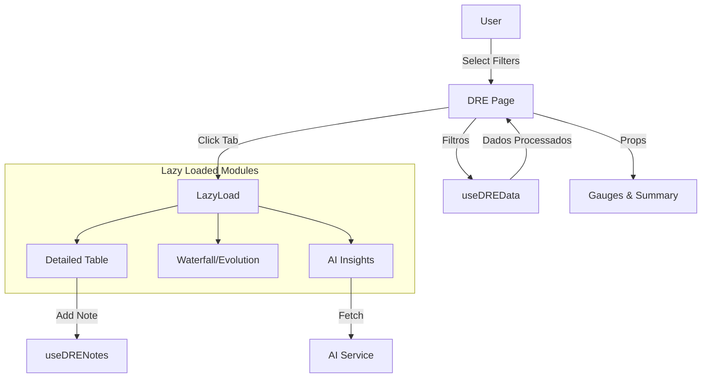

# Alexandria Project: DRE Page (The Executive Dashboard)

> **"O Painel de Controle do CEO."**

---

## 5W2H Matrix: The Essence

| Dimension | Description |
| :--- | :--- |
| **WHO** (Quem) | O Tomador de Decisão (CEO, CFO). É a tela onde ele passa a maior parte do tempo analisando a saúde da empresa. |
| **WHAT** (O Que) | A **View Principal** do módulo DRE. Um dashboard rico, com abas navegáveis, gráficos lazy-loaded, insights de IA e ferramentas de exportação (PDF/Excel). |
| **WHY** (Por Que) | **Centralização de Inteligência**. Não basta mostrar números; é preciso contar história. Por isso temos abas de "Análise de IA" e "Notas Explicativas" integradas aos dados brutos. |
| **WHERE** (Onde) | Arquivo: `src/modules/finance/dre/index.tsx`.<br>Rota: `/financeiro/dre`. |
| **WHEN** (Quando) | Ao acessar o menu "Relatórios > DRE". |
| **HOW** (Como) | Implementa **Code Splitting** agressivo (`React.lazy`) para carregar gráficos pesados apenas quando a aba é clicada. Gerencia estado de filtros globais (Período, Regime) que cascateiam para todos os sub-componentes via props. |
| **HOW MUCH** (Quanto) | **Complexidade de UI**: Extrema. Muitos componentes móveis, animações (`framer-motion`) e estados interativos. |

---

## Seção A: Manual de Operações (User Guide)

### 1. Navegação por Abas (The Multi-Lens View)
O DRE oferece 8 visões diferentes sobre os mesmos dados:
1.  **Demonstrativo**: A tabela clássica contábil.
2.  **Indicadores**: Margem Bruta, EBITDA, Liquidez.
3.  **Gráficos**: Waterfall e Evolução Temporal.
4.  **Categorias**: Breakdown de onde vem o dinheiro.
5.  **Ano a Ano**: Comparativo YOY (Year Over Year).
6.  **Orçamento**: Previsto vs Realizado.
7.  **Análise IA**: O "Consultor Virtual" explicando os números.
8.  **Automação**: Agendamento de envio de relatórios por e-mail.

### 2. Filtros Globais
No topo (ou no menu colapsável em mobile), o usuário controla o "Espaço-Tempo":
*   **Período**: Mês, Trimestre, Semestre, Anal.
*   **Regime**: Competência (Fato Gerador) vs Caixa (Financeiro).
*   **Comparação**: Contra o Período Anterior ou contra a Meta (Orçamento).

### 3. Ferramentas de Produtividade
*   **Exportação**: Geração de PDF bonitos (para reuniões) ou Excel (para analistas).
*   **Notas**: O usuário pode clicar em qualquer linha (ex: "Despesas de Viagem") e adicionar uma nota explicativa ("Aumento devido à convenção anual").

---

## Seção B: A Engenharia Profunda (Technical Docs)

### 1. Performance Optimization (Code Splitting)
Como o DRE é pesado, usamos `React.lazy` para quase tudo que não está na tela inicial.
```typescript
const DREWaterfallChart = lazy(() => import("./components/DREWaterfallChart"));
```
*   *Benefício*: O "First Contentful Paint" é rápido. Os gráficos só baixam o bundle JS se o usuário clicar na aba "Gráficos".

### 2. State Propagation Filters
O componente `DRE` age como o "Maestro". Ele detém o estado do `period`, `accountingRegime`, etc.
*   Ele passa esses estados para o hook `useDREData`.
*   Recebe os dados processados (`summary`, `indicators`).
*   Redistribui esses dados para os componentes filhos (`DREHeroGauges`, `DREExecutiveSummary`).
*   *Padrão*: Prop Drilling (aceitável aqui pois é apenas 1 nível de profundidade).

### 3. AI Integration
A aba "Análise IA" não é estática.
*   Ela observa mudanças no `summary` (via `useEffect`).
*   Se os números mudam, ela pode (sob demanda) chamar o `fetchAnalysis` para pedir ao LLM que reinterprete o novo cenário financeiro.

---

## Seção C: Arquitetura e Fluxo


