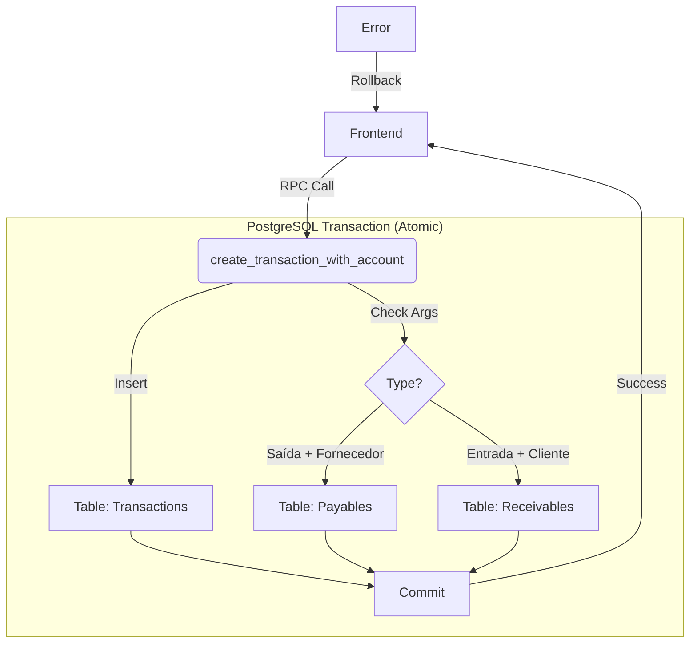
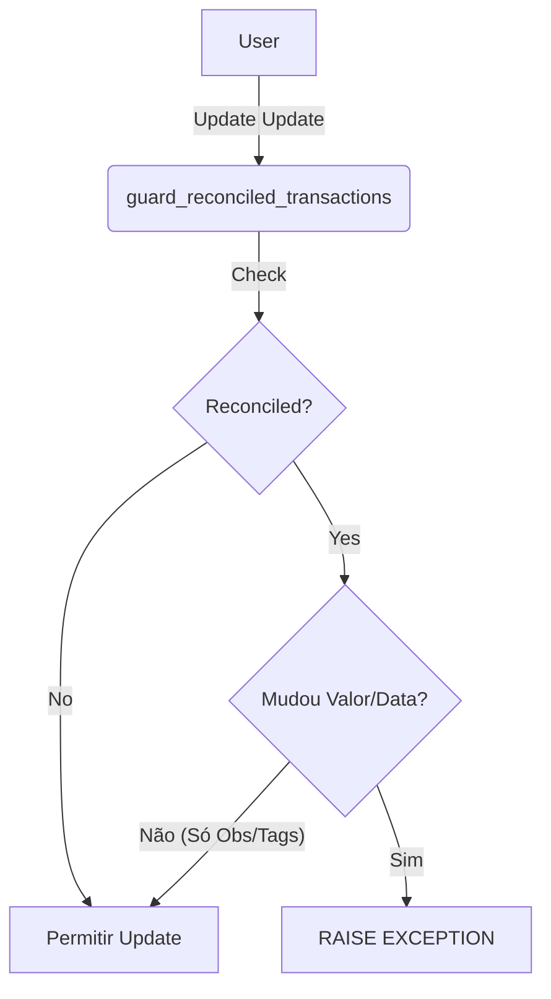

# Alexandria Project: Database Integrity & ACID Procedures

> **"A verdade não vive no Frontend; ela vive no Banco de Dados."**

---

## 5W2H Matrix: The Essence

| Dimension | Description |
| :--- | :--- |
| **WHO** (Quem) | O Banco de Dados (PostgreSQL). Essas regras são aplicadas independentemente de quem faz a chamada (Backend, Dashboard, API ou SQL Direto). |
| **WHAT** (O Que) | Um conjunto de **Stored Procedures** e **Triggers** que garantem consistência atômica. Inclui criação de transações com contas a pagar/receber vinculadas, proteção contra edição de itens conciliados e trilhas de auditoria. |
| **WHY** (Por Que) | **Integridade Financeira**. Evita registros órfãos (ex: uma Saída sem o "Contas a Pagar" correspondente) e fraudes (edição de transações já conciliadas/fechadas). |
| **WHERE** (Onde) | Arquivo: `supabase/migrations/20260216_audit_acid_procedures.sql`.<br>DB Schema: `public` procedures. |
| **WHEN** (Quando) | Sempre que uma transação financeira é Criada, Editada ou Deletada. |
| **HOW** (Como) | Usa recursos nativos do PL/pgSQL: `BEGIN/COMMIT` implícitos para atomicidade, `RAISE EXCEPTION` para guardas de validação e `TRIGGERS` para auditoria automática (log). |
| **HOW MUCH** (Quanto) | **Custo de Performance**: Baixo (Execução nativa no motor do DB). É muito mais rápido do que fazer 3 chamadas de rede separadas do Frontend. |

---

## Seção A: Manual de Operações (User Guide)

### 1. Criando Transações (The Happy Path)
Ao invés de inserir na tabela `transactions` manualmente, o Frontend deve chamar a RPC:

```typescript
const { data, error } = await supabase.rpc('create_transaction_with_account', {
  p_company_id: '...',
  p_amount: 500.00,
  p_type: 'saida',
  p_nature: 'realizado',
  p_supplier_id: '...' // Isso cria automaticamente o Payable vinculado!
});
```

**Resultado**: O sistema cria 1 linha em `transactions` E 1 linha em `payables`. Se um falhar, ambos falham. (Tudo ou Nada).

### 2. O que é Bloqueado? (The Danger Zone)
*   **Edição de Conciliados**: Se `reconciled = true`, você **NÃO** pode mudar valor, data ou conta bancária.
    *   *Mensagem de Erro*: "Transação conciliada não pode ser editada. Use estorno + novo lançamento."
    *   *Solução*: O usuário deve fazer um Estorno (Reversal), que cria uma transação contrária anulando o saldo.

---

## Seção B: A Engenharia Profunda (Technical Docs)

### 1. Atomic Transaction Creation (`create_transaction_with_account`)
Esta função resolve o problema clássico de "Distributed Writes" em sistemas client-side.
*   **Antes**: O Frontend criava a Transação -> Sucesso -> Criava a Conta a Pagar -> Falha (Internet caiu).
    *   *Resultado*: Dinheiro saiu do caixa, mas a dívida não foi baixada. Erro contábil.
*   **Agora (ACID)**:
    1.  `INSERT INTO transactions ... RETURNING id`.
    2.  `IF type='saida' ... INSERT INTO payables`.
    3.  `IF type='entrada' ... INSERT INTO receivables`.
    4.  Se qualquer passo der erro, o Postgres faz **ROLLBACK** automático de tudo.

### 2. Reconciliation Guard (`guard_reconciled_transactions`)
Um Trigger `BEFORE UPDATE` que age como um cão de guarda.
*   Ele permite *Soft Delete* (`is_deleted` muda de false para true), pois precisamos poder "cancelar" erros.
*   Mas ele bloqueia alterações em campos financeiros (`amount`, `transaction_date`) se a transação já foi conciliada com o extrato bancário.
*   *Analogia Feynman*: Depois que você assina um cheque e o banco desconta, você não pode usar "liquid paper" para mudar o valor. Você precisa rasgar (estornar) e fazer outro.

### 3. Audit Trails & Gap Filling
A migração também instala triggers de auditoria em tabelas críticas que foram esquecidas anteriormente (`debts`, `payment_records`, `categories`).
*   Isso garante que **quem**, **quando** e **o que** mudou seja gravado na tabela `audit_logs` (ou similar, via função `log_audit`). Nada passa despercebido.

---

## Seção C: Arquitetura e Fluxo




