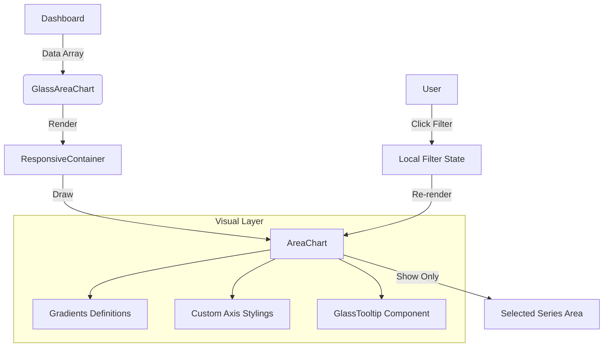

# Alexandria Project: GlassAreaChart

> **"A Estética dos Dados."**

---

## 5W2H Matrix: The Essence

| Dimension | Description |
| :--- | :--- |
| **WHO** (Quem) | O usuário final, visualizando tendências macro (Dashboard) ou micro (Relatórios). Componente puramente visual. |
| **WHAT** (O Que) | Um gráfico de área estilizado com **Glassmorphism**. Usa `recharts` sob o capô, mas encapsula toda a complexidade de gradientes (Dourado/Verde), tooltips customizados e eixos responsivos. |
| **WHY** (Por Que) | **Consistência Visual**. Gráficos padrões de bibliotecas destoam do design "Premium/Dark" do sistema. Este componente garante que até os dados pareçam parte da interface de vidro. |
| **WHERE** (Onde) | Arquivo: `src/components/glass/GlassAreaChart.tsx`. Uso: Dashboard Principal, DRE. |
| **WHEN** (Quando) | Sempre que é necessário mostrar evolução temporal de duas métricas comparáveis (ex: Receitas vs Despesas). |
| **HOW** (Como) | Recebe um array de dados simples. Gerencia internamente um filtro rápido (Todas/Receitas/Despesas) que anima a opacidade das séries, permitindo focar em uma linha específica sem recarregar os dados. |
| **HOW MUCH** (Quanto) | **Peso**: Médio (Recharts é pesado). Deve ser sempre carregado via `lazy` se não estiver na dobra inicial. |

---

## Seção A: Manual de Operações (User Guide)

### 1. Dual Mode State (Internal vs External)
O componente é híbrido:
*   **Modo Controlado**: Se você passar `selectedPeriod` e `onPeriodChange`, o Pai controla o filtro de data (ex: Dashboard Global).
*   **Modo Autônomo**: Se você não passar nada, o gráfico cria seu próprio estado interno para os botões "Dia/Mês/Ano".

### 2. Interatividade Local
O usuário pode clicar nas pílulas "Receitas" ou "Despesas" dentro do próprio card.
*   Isso não refaz a query no banco.
*   Apenas esconde visualmente a série não desejada (`filter state`), permitindo uma análise mais limpa de uma única métrica.

---

## Seção B: A Engenharia Profunda (Technical Docs)

### 1. SVG Gradients Definition
Para atingir o visual "Neon/Cyberpunk", não usamos cores sólidas.
Definimos `<linearGradient>` dentro do SVG:
*   **Gold Gradient** (`#C5A059`): Começa com 40% opacidade e vai a 0%.
*   **Green Gradient** (`#7DC4B4`): Idem.
Isso cria o efeito de "brilho" na área abaixo da linha, enquanto o topo (stroke) permanece nítido e sólido (2px).

### 2. Responsive Container Hack
O `recharts` tem problemas conhecidos com Flexbox.
*   Solução: `div className="h-[280px] -mx-2"`.
*   A altura fixa é necessária para o cálculo do SVG. As margens negativas compensam o padding do Card, permitindo que o gráfico "sangre" até as bordas laterais para imersão total.

### 3. Memoization
O componente é protegido por `React.memo`.
*   Como gráficos são caros para redenrizar (muitos nós DOM/SVG), só permitimos re-render se `data` ou `selectedPeriod` mudarem referencialmente.

---

## Seção C: Arquitetura e Fluxo

