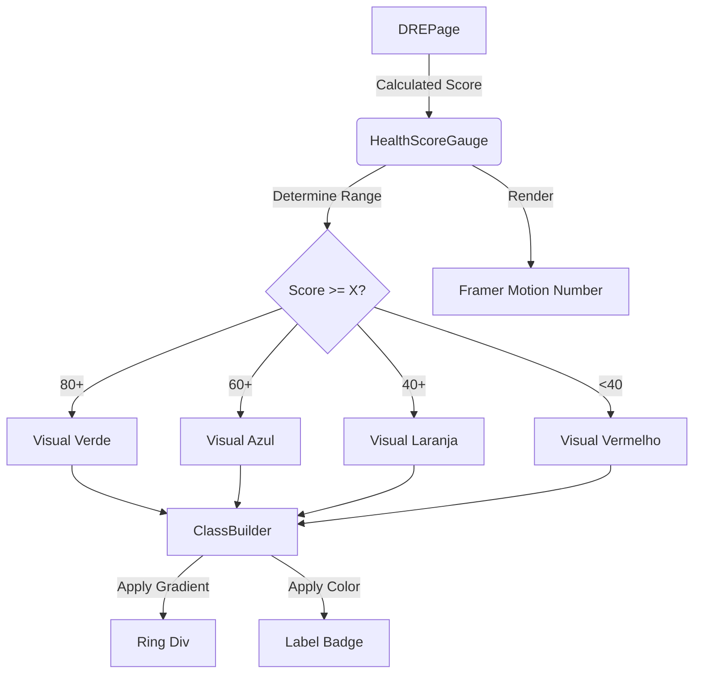

# Alexandria Project: HealthScoreGauge

> **"O Termômetro do Negócio."**

---

## 5W2H Matrix: The Essence

| Dimension | Description |
| :--- | :--- |
| **WHO** (Quem) | O Executivo. É a primeira coisa que ele olha no DRE para ter um feedback instantâneo (Verde/Amarelo/Vermelho). |
| **WHAT** (O Que) | Um componente visual de **Gamificação Financeira**. Transforma métricas complexas (Margem, EBITDA, Crescimento) em uma nota única de 0 a 100. |
| **WHY** (Por Que) | **Redução de Carga Cognitiva**. O usuário não precisa analisar 50 linhas do DRE para saber se a empresa vai bem. Se o Score for 85 (Verde), ele relaxa. Se for 40 (Vermelho), ele investiga. |
| **WHERE** (Onde) | Arquivo: `src/modules/finance/dre/components/HealthScoreGauge.tsx`.<br>Uso: Topo da página DRE. |
| **WHEN** (Quando) | Calculado sempre que o DRE é atualizado. |
| **HOW** (Como) | Recebe um `score` numérico. Usa lógica de ranges (0-40, 40-60, 60-80, 80-100) para determinar a cor do gradiente (Rose, Amber, Teal, Emerald) e a mensagem de feedback. Anima a entrada com `framer-motion`. |
| **HOW MUCH** (Quanto) | **Peso**: Leve. Componente puramente visual (dumb component). A inteligência do cálculo do score vem de fora (via `useDREAIInsights` ou lógica manual). |

---

## Seção A: Manual de Operações (User Guide)

### 1. Interpretando o Score
O "Score de Saúde" não é um número aleatório. Ele segue a escala de rating de crédito:
*   **0-39 (Crítico / Vermelho)**: A empresa está queimando caixa ou operando com prejuízo crônico.
*   **40-59 (Regular / Laranja)**: Margens apertadas, risco de insolvência se houver imprevistos.
*   **60-79 (Bom / Azul-Teal)**: Operação saudável, lucro consistente, mas com espaço para otimização.
*   **80-100 (Excelente / Verde)**: Máquina de vendas. Margens altas e crescimento sustentável.

### 2. Onde ele aparece?
Ele é onipresente no módulo financeiro, servindo como um "selo de qualidade" do período analisado.
*   *Nota*: O Score muda conforme o filtro de data. Uma empresa pode ser "Excelente" no ano, mas ter tido um mês "Crítico".

---

## Seção B: A Engenharia Profunda (Technical Docs)

### 1. Gradient Architecture
Para manter o visual moderno ("Glass/Neon"), o componente não usa cores chapadas.
Ele mapeia o score para pares de cores tailwind:
```typescript
if (score >= 80) return { gradient: "from-emerald-500 to-green-600", ... };
```
Esses gradientes são aplicados tanto no anel de progresso quanto no Badge de status, criando coesão visual.

### 2. Animation Strategy
Usa `framer-motion` para dar peso ao número.
*   `initial={{ scale: 0.5, opacity: 0 }}`
*   `animate={{ scale: 1, opacity: 1 }}`
Isso faz o número "saltar" na tela, reforçando a ideia de gamificação/conquista.

### 3. Responsividade
O componente aceita uma prop `size` ("sm", "md", "lg").
*   **lg**: Usado no Dashboard principal (Destaque).
*   **sm**: Usado em cards resumo ou listas laterais.
Isso permite reutilizar a mesma lógica visual em contextos de hierarquia diferente.

---

## Seção C: Arquitetura e Fluxo


