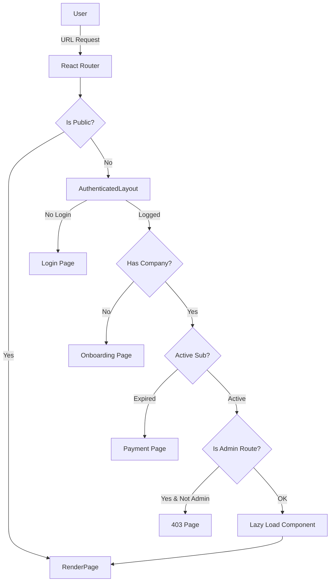

# Alexandria Project: Routing Architecture

> **"O Mapa do Tesouro."**

---

## 5W2H Matrix: The Essence

| Dimension | Description |
| :--- | :--- |
| **WHO** (Quem) | O sistema nervoso central. Todos os links, redirecionamentos e proteções passam por aqui. |
| **WHAT** (O Que) | Uma arquitetura de duas camadas: **Definição** (`lib/routes.ts`) e **Implementação** (`app/routes.tsx`). Garante que nenhuma string de URL seja hardcoded ("Single Source of Truth"). |
| **WHY** (Por Que) | **Segurança e Manutenibilidade**. Se mudarmos a URL do DRE de `/relatorios/dre` para `/financeiro/resultados`, mudamos em *uma linha* e o app inteiro atualiza, sem links quebrados. Além disso, garante que ninguem acesse `/dashboard` sem pagar. |
| **WHERE** (Onde) | `src/lib/routes.ts` (Constantes) e `src/app/routes.tsx` (Componentes). |
| **WHEN** (Quando) | Sempre que o usuário clica em um link ou digita uma URL. |
| **HOW** (Como) | Usa `react-router-dom` v6 com `RouteObject[]`. Implementa Guards (`RequireAuth`, `RequireSubscription`) como wrappers ao redor das rotas protegidas. |
| **HOW MUCH** (Quanto) | **Cobertura**: 100% das páginas. Inclui tratamento de 404 e redirecionamento de rotas legadas. |

---

## Seção A: Manual de Operações (User Guide)

### 1. Centralized Route Constants
Nunca escreva `<Link to="/dashboard">`. Use `<Link to={MAIN_ROUTES.DASHBOARD}>`.
O arquivo `lib/routes.ts` exporta grupos lógicos:
*   `PUBLIC_ROUTES`: Login, Landing Pages.
*   `MAIN_ROUTES`: Core do sistema (Financeiro, CRM).
*   `ADMIN_ROUTES`: Área do Super Admin (nós).
*   `LEGACY_ROUTES`: Redirecionamentos para manter compatibilidade com links antigos (SEO/Bookmarks).

### 2. Route Guards (The Bouncers)
As rotas não são apenas públicas ou privadas. Existem camadas de proteção:
1.  **AuthenticatedLayout**: Usuário está logado?
2.  **RequireCompany**: Usuário selecionou uma empresa?
3.  **RequireActiveSubscription**: A empresa pagou o boleto?
4.  **RequireAdmin**: O usuário é Deus (Super Admin)?

### 3. Builder Pattern
Para rotas dinâmicas, usamos a função helper:
```typescript
// Em vez de: `/users/${id}/edit`
buildRoute(ADMIN_ROUTES.USERS, userId, 'edit')
```
Isso garante encoding correto de caracteres especiais na URL.

---

## Seção B: A Engenharia Profunda (Technical Docs)

### 1. Legacy Migration Layer
O sistema possui um mapa de redirecionamento `LEGACY_ROUTES`.
*   Se o usuário acessar `/movimentacoes` (antigo), o router intercepta:
    ```tsx
    { path: LEGACY_ROUTES.TRANSACTIONS, element: <Navigate to={MAIN_ROUTES.TRANSACTIONS} replace /> }
    ```
*   Isso preserva bookmarks antigos e evita frustração do usuário.

### 2. Context Isolation
Observe o uso de `SearchContextOutlet`.
*   Algumas rotas compartilham estado global de busca (barra superior).
*   Ao envolver rotas específicas (dashboard, clientes) neste outlet, permitimos que a barra de busca global filtre o conteúdo da página ativa sem prop drilling complexo.

### 3. Code Splitting Strategy
Todas as rotas são importadas via `lazy`.
```typescript
const Dashboard = lazy(() => import("@/modules/analytics/dashboard"));
```
*   O bundle JS da página "Dashboard" só é baixado quando o usuário entra nela.
*   Isso mantém o *Initial Load* do app extremamente leve, mesmo que o sistema tenha 500 páginas.

---

## Seção C: Arquitetura e Fluxo


