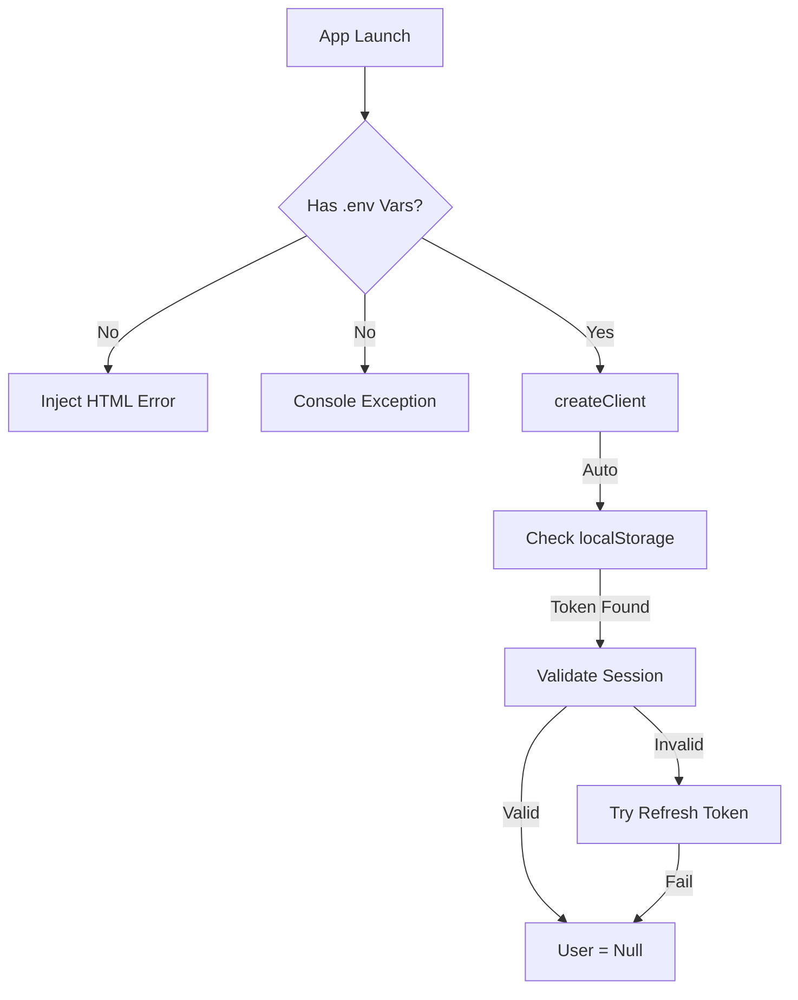

# Alexandria Project: Supabase Client

> **"O Porteiro do Banco de Dados."**

---

## 5W2H Matrix: The Essence

| Dimension | Description |
| :--- | :--- |
| **WHO** (Quem) | O Singleton. A única instância autorizada a falar com o back-end. |
| **WHAT** (O Que) | Um cliente HTTP/WebSocket configurado com a chave pública (`VITE_SUPABASE_PUBLISHABLE_KEY`). Ele gerencia autenticação, real-time subscriptions e queries ao Postgres. |
| **WHY** (Por Que) | **Segurança e Abstração**. Ao invés de fazer `fetch('https://api.supabase...')` manualmente, usamos métodos tipados como `supabase.from('users').select()`. Isso previne SQL Injection e garante que o TS acuse erro se tentarmos acessar uma coluna que não existe. |
| **WHERE** (Onde) | Arquivo: `src/integrations/supabase/client.ts`. |
| **WHEN** (Quando) | Instanciado imediatamente no load da página. |
| **HOW** (Como) | Usa a biblioteca `@supabase/supabase-js`. Inclui um "Fail Fast Check": se as variáveis de ambiente não existirem, ele injeta um HTML de erro na tela para avisar o desenvolvedor (evitando telas brancas silenciosas). |
| **HOW MUCH** (Quanto) | **Custo**: 1 conexão por aba. O cliente gerencia o refresh de tokens (JWT) automaticamente. |

---

## Seção A: Manual de Operações (User Guide)

### 1. Fail Fast Mechanism
Se você clonar o projeto e esquecer o `.env`, o app não vai carregar "pela metade".
*   Ele verifica `VITE_SUPABASE_URL` e `KEY` na inicialização.
*   Se faltar, ele substitui o `<div id="root">` por uma mensagem de erro estilizada (Fundo verde escuro, texto claro) orientando a configurar a Vercel/Env.

### 2. Type Safety (`Database` Type)
O cliente é genérico: `createClient<Database>(...)`.
*   O tipo `Database` é gerado automaticamente via CLI (`supabase gen types`).
*   Isso garante IntelliSense total. Se você digitar `.from('userrs')` (typo), o VS Code sublinha em vermelho na hora.

---

## Seção B: A Engenharia Profunda (Technical Docs)

### 1. Auth Persistence
Configurado com:
```typescript
auth: {
  storage: localStorage,
  persistSession: true,
  autoRefreshToken: true,
}
```
*   **Auto Refresh**: O token JWT expira em 1 hora. O cliente renova silenciosamente em background usando o Refresh Token.
*   **Storage**: Salva a sessão no LocalStorage, permitindo que o login persista entre reloads.

### 2. Import Meta Env
Usa `import.meta.env` (padrão Vite) em vez de `process.env`.
*   Isso garante compatibilidade com Edge Runtimes e evita problemas de bundler.

---

## Seção C: Arquitetura e Fluxo


