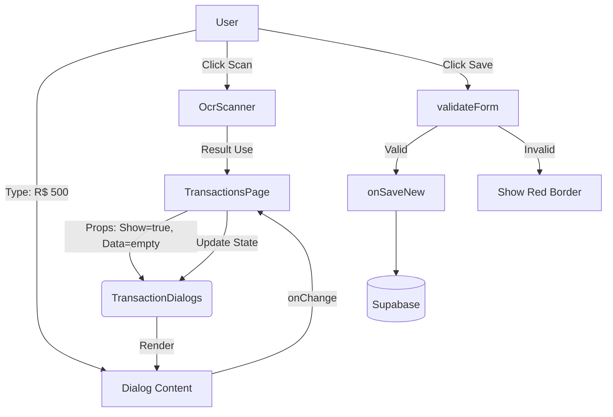

# Alexandria Project: TransactionDialogs

> **"A Grande Porta de Entrada."**

---

## 5W2H Matrix: The Essence

| Dimension | Description |
| :--- | :--- |
| **WHO** (Quem) | O Operador Financeiro. É aqui que o trabalho manual acontece (quando não há integração bancária automática). |
| **WHAT** (O Que) | Um **Mega-Componente** que gerencia os modais de `Criação`, `Edição`, `Visualização`, `Exclusão` e `Auditoria` de transações. Ele também orquestra sub-modais de "Cadastro Rápido" (Cliente, Fornecedor, Categoria). |
| **WHY** (Por Que) | **Centralização de Estado**. Ao invés de espalhar 5 diálogos diferentes pela página e gerenciar seus `isOpen` individualmente, este componente age como um "Hub". Se você quer abrir um dialog, você fala com este Hub. |
| **WHERE** (Onde) | Arquivo: `src/modules/finance/transactions/components/TransactionDialogs.tsx`.<br>UI: Invocado pelo botão "+ Nova Transação" ou ao clicar em uma linha da tabela. |
| **WHEN** (Quando) | Sempre que o usuário decide interagir (criar, editar, ver detalhes) com uma transação. |
| **HOW** (Como) | Recebe, via props, todos os controles (`showNewDialog`, `onSaveNew`, etc) e os dados auxiliares (`bankAccounts`, `categories`). Ele valida o formulário localmente antes de chamar as funções de salvamento (Padrão "Gatekeeper"). Integra recursos avançados como **OCR** (Scan de Nota Fiscal) e **Recorrência**. |
| **HOW MUCH** (Quanto) | **Complexidade Visual**: Alta. Possui abas, formulários condicionais e validações em tempo real.<br>**Performance**: Usar `memo` é crucial aqui pois ele recebe muitas props que mudam frequentemente. |

---

## Seção A: Manual de Operações (User Guide)

### 1. Como Usar (The Happy Path)
Este componente não é usado isoladamente; ele é montado na raiz da página de Transações.
O fluxo típico de uso é:
1.  Usuário clica em "Nova Transação".
2.  Pai define `showNewDialog={true}` e passa os dados.
3.  `TransactionDialogs` renderiza o Modal.
4.  Componente gerencia inputs (Valor, Data, Descrição).
5.  Usuário clica em "Salvar".
6.  Componente valida -> Chama `onSaveNew()`.

### 2. Funcionalidades Avançadas
*   **OCR Scanner**: Permite que o usuário tire foto ou suba PDF de um boleto. O componente preenche automaticamente Valor, Data e Descrição.
*   **Cadastro Rápido**: Se o cliente não existe, o usuário clica no ícone (+) ao lado do select, abre um mini-modal, cadastra e já volta com ele selecionado. (UX Fluida).
*   **Recorrência**: Transforma uma transação simples em "Parcelada" (12x) ou "Fixa" (Todo mês).

### 3. KPIs & Validações
O formulário impõe regras estritas antes de incomodar o servidor:
*   **Valor**: Não pode ser zero.
*   **Descrição**: Obrigatória.
*   **Conta & Categoria**: Obrigatórios (para integridade dos relatórios).

---

## Seção B: A Engenharia Profunda (Technical Docs)

### 1. State Management (O Hub "Stateless")
Curiosamente, este componente é quase **Stateless** em relação aos dados principais.
*   Ele **NÃO** mantém o estado da transação (`formData`).
*   Quem mantém é o Pai (`useTransactionsActions`).
*   Ele apenas *exibe* o `formData` e notifica mudanças via `onNewFormDataChange`.
*   *Por que?* Para que o Pai possa limpar o form, pré-preencher dados ou validar regras de negócio complexas sem "magia" escondida dentro do modal.

### 2. OCR Integration (A Visão Computacional)
O componente `<OcrScanner />` é acionado via botão.
*   Ao retornar sucesso (`handleOcrResult`), ele faz um **Merge Inteligente**:
    ```typescript
    onNewFormDataChange({
      ...formData,
      amount: scanned.amount || formData.amount, // Só substitui se o scan achou algo
      date: scanned.date || formData.date
    })
    ```
    Isso respeita o que o usuário já tinha digitado, apenas preenchendo as lacunas (ou corrigindo).

### 3. Conditional Rendering (Campos Dinâmicos)
O formulário respira e muda conforme o contexto:
*   Se `type === 'entrada'`: Mostra "Cliente" e "Recebimento". O ícone fica Verde.
*   Se `type === 'saida'`: Mostra "Fornecedor" e "Pagamento". O ícone fica Vermelho.
*   Se `nature === 'previsao'`: Abre a seção de "Confiança" (Slider 0-100%) e Tipo de Previsão (Orçamento vs Estimativa).

> *Analogia Feynman*: É como um Camaleão. A estrutura óssea (o código) é a mesma, mas a pele (os campos) muda de cor instantaneamente dependendo se ele está na folha verde (Entrada) ou no tronco marrom (Saída).

---

## Seção C: Arquitetura e Fluxo


