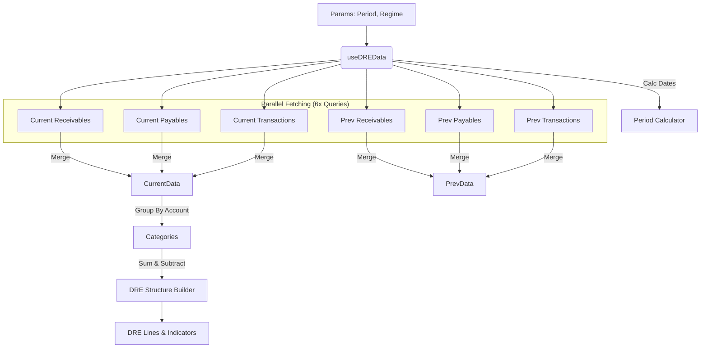

# Alexandria Project: useDREData

> **"O Auditor Contábil Automatizado."**

---

## 5W2H Matrix: The Essence

| Dimension | Description |
| :--- | :--- |
| **WHO** (Quem) | O Cérebro por trás da tela de DRE (Demonstração do Resultado do Exercício). Usado pela `DREPage` para montar o relatório financeiro mais importante da empresa. |
| **WHAT** (O Que) | Um **Hook de Agregação e Cálculo**. Ele busca receitas, custos e despesas de 3 tabelas diferentes (`receivables`, `payables`, `transactions`), normaliza os dados e calcula as linhas clássicas do DRE (Lucro Bruto, EBITDA, Lucro Líquido). |
| **WHY** (Por Que) | **Visão Estratégica**. Enquanto o `useTransactionsData` mostra o "extrato bancário" (micro), este hook mostra a "saúde do negócio" (macro). Ele responde: "A empresa dá lucro ou só gira dinheiro?". |
| **WHERE** (Onde) | Arquivo: `src/modules/finance/dre/hooks/useDREData.ts`. |
| **WHEN** (Quando) | Ao abrir a aba "Relatórios > DRE" ou mudar o regime (Caixa/Competência). |
| **HOW** (Como) | Faz 6 queries em paralelo (3 para o período atual, 3 para o anterior) para comparar performance. Agrupa os lançamentos pelo `chart_of_accounts` e soma os totais. Depois, aplica a fórmula contábil: `Receita - Custos = Bruto - Despesas = Líquido`. |
| **HOW MUCH** (Quanto) | **Complexidade de Dados**: Alta. Precisa lidar com transações soltas + contas a pagar/receber, evitando duplicatas a intersecções de datas complexas. |

---

## Seção A: Manual de Operações (User Guide)

### 1. Regimes Contábeis (The Mode Switch)
O hook suporta nativamente os dois modos:
*   **Competência (`accountingRegime="competencia"`)**: Considera a data de *emissão/vencimento*. Importante para ver o que *deveria* ter entrado.
*   **Caixa (`accountingRegime="caixa"`)**: Considera apenas o que foi *pago/recebido* (Filtra `status = 'pago'`). Importante para ver o dinheiro que realmente existe.

### 2. Modos de Comparação
*   **Período (`comparisonMode="period"`)**: Compara "Jan 2024" vs "Jan 2023" (Análise Horizontal).
*   **Orçado vs Realizado (`comparisonMode="budget"`)**: Compara "O que aconteceu" (`nature='realizado'`) vs "O que estava no plano" (`nature='previsao'`).

### 3. Estrutura do Relatório
O DRE gerado segue estritamente o padrão contábil brasileiro:
1.  (+) Receita Operacional Bruta
2.  (-) Deduções (Impostos, Devoluções)
3.  (=) Receita Líquida
4.  (-) Custos (CMV/CSV)
5.  (=) Lucro Bruto
6.  (-) Despesas Operacionais (Aluguel, Folha, Marketing)
7.  (=) Resultado Operacional (EBITDA)
8.  (=) Resultado Líquido

---

## Seção B: A Engenharia Profunda (Technical Docs)

### 1. Data Aggregation Strategy
O maior desafio aqui é que os dados financeiros estão espalhados.
*   **Receitas**: Podem vir de `receivables` (Boletos emitidos) OU `transactions` (Vendas à vista/Pix).
*   **Despesas**: Podem vir de `payables` (Faturas) OU `transactions` (Compras no débito).
*   **Solução**: O hook faz queries em todas as fontes e executa um **Merge** arrays:
    ```typescript
    const mergedRevenue = [...receivables, ...cashTransactions];
    ```
    Isso garante que nada seja esquecido.

### 2. Query Key Stability
Para garantir um cache eficiente no React Query, a `queryKey` é composta por todos os parâmetros vitais:
```typescript
const periodKey = `${period}_${regime}_${mode}_${start}_${end}`;
```
Isso significa que se o usuário alternar entre "Caixa" e "Competência", o React Query trata como duas tabelas diferentes em cache, permitindo alternância instantânea após o primeiro carregamento.

### 3. Dynamic Categorization
Ao contrário de DREs estáticos, este hook constrói as linhas intermediárias dinamicamente baseadas no `chart_of_accounts`.
*   Se você criar uma nova conta "Marketing Digital" no Plano de Contas, ela aparecerá automaticamente dentro do grupo "Despesas Operacionais", pois o agrupamento é feito via código (`.code`).

---

## Seção C: Arquitetura e Fluxo


