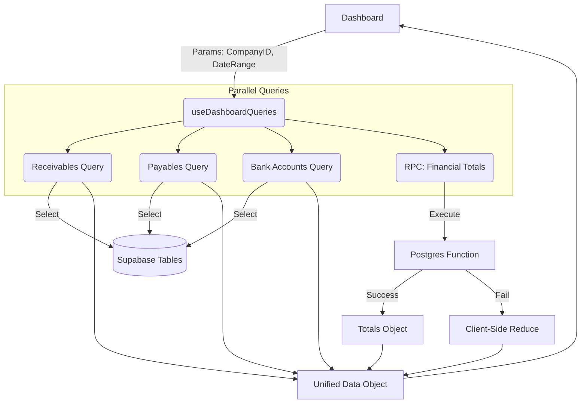

# Alexandria Project: useDashboardQueries

> **"Uma orquestra precisa de um maestro; o Dashboard precisa deste Hook."**

---

## 5W2H Matrix: The Essence

| Dimension | Description |
| :--- | :--- |
| **WHO** (Quem) | O pulmão do **Dashboard Financeiro**. Qualquer componente que precise de "visão geral" (KPIs, Listas Recentes, Saldos) bebe desta fonte. |
| **WHAT** (O Que) | Um **Hook Unificado** que paralelas múltiplas requisições (Receitas, Despesas, Bancos, Transações). Ele entrega dados brutos, totais calculados e estados de carregamento granulares. |
| **WHY** (Por Que) | **Performance & Consistência**. Ao invés de cada widget disparar sua própria query (causando "Waterfalls" de rede), centralizamos tudo aqui. Se 10 widgets precisam do Saldo Bancário, apenas 1 request é feito. |
| **WHERE** (Onde) | Arquivo: `src/modules/analytics/dashboard/hooks/useDashboardQueries.ts`.<br>UI: Alimenta todo o Grid do Dashboard (`DashboardPage.tsx`). |
| **WHEN** (Quando) | No **Mount** do Dashboard e sempre que o **Período** (Mês/Ano) ou a **Empresa** mudam. |
| **HOW** (Como) | Utiliza `useQuery` do TanStack Query em paralelo. Tenta buscar totais via **RPC Function** (Server-side) para velocidade; se falhar, faz **Fallback** para cálculo no cliente (Client-side aggregation). |
| **HOW MUCH** (Quanto) | **Custo Computacional**: Varía. Com RPC é O(1). Sem RPC é O(N) (soma arrays no lado do cliente).<br>**Custo de API**: 6-7 requests simultâneos (multiplexados via HTTP/2). |

---

## Seção A: Manual de Operações (User Guide)

### 1. Como Usar (The Happy Path)
Este hook é o "Buffet Livre" do Dashboard. Você chama uma vez e pega o que quiser.

```typescript
import { useDashboardQueries } from "./hooks/useDashboardQueries";

// Dentro do componente (ex: DashboardPage):
const { 
  receivables,      // Array de contas a receber
  bankAccounts,     // Array de contas bancárias
  financialTotals,  // Objeto com { receitas, despesas, saldo }
  isLoading         // True se ALGO estiver carregando
} = useDashboardQueries(companyId, dateRange);

if (isLoading) return <Skeleton />;
```

### 2. Como NÃO Usar (The Danger Zone)
*   **Não use para Relatórios Detalhados**: Este hook limita listas (ex: `transactions` tem limit 50). Para relatórios completos (CSV, PDF), use hooks dedicados com paginação.
*   **Não ignore o `dateRange`**: Se você não passar um `dateRange`, ele pode tentar buscar "tudo" ou falhar em filtros temporais sensíveis.

### 3. KPIs & Fórmulas (Fallback Logic)
Se a RPC falhar, o cálculo de Receitas é feito assim (Client-Side):

$$
\text{Total Receitas} = \sum (\text{amount}) \text{ onde } \text{type} = \text{'entrada'} \land \text{nature} = \text{'realizado'}
$$

---

## Seção B: A Engenharia Profunda (Technical Docs)

### 1. Hooks & State (A Orquestra Assíncrona)
O hook dispara ~7 queries em paralelo.
*   **Stale Time**: `STALE_TIMES.FINANCIAL` (geralmente curto/médio).
*   **Isolamento**: Cada query tem sua chave (`dashboardKeys.receivables`, etc). Isso permite que, se você atualizar só uma Despesa, invalidamos apenas a query de Despesas, sem recarregar os Bancos.

### 2. Edge Functions & RPC (A Via Expressa)
O hook implementa um padrão de **Hybrid Computing**:
1.  **Tentativa A (Otimizada):** Chama `rpc('get_financial_totals')`. O banco soma tudo e retorna só o resultado final. (Rápido, leve).
2.  **Tentativa B (Fallback):** Se a RPC não existir ou der erro, o hook baixa as transações e soma via Javascript `reduce()`. (Robusto, funciona mesmo sem deploy de função).

> *Analogia Feynman*: É como pedir uma pizza.
> *   **RPC**: Você liga e pede a pizza pronta (O banco cozinha e entrega).
> *   **Fallback**: Você vai no mercado, compra farinha, tomate e faz a pizza em casa (O cliente processa os dados). O resultado é o mesmo (pizza), mas o esforço muda.

### 3. Filters & Guards
*   `enabled: !!companyId`: O hook fica "dormente" até que uma empresa seja selecionada. Nenhuma request é disparada "sem querer".
*   `dateRange`: Filtra `receivables`, `payables` e `transactions` pelo `due_date` ou `transaction_date`. Essencial para alternar entre "Visão Mensal" vs "Visão Anual".

---

## Seção C: Arquitetura e Fluxo


