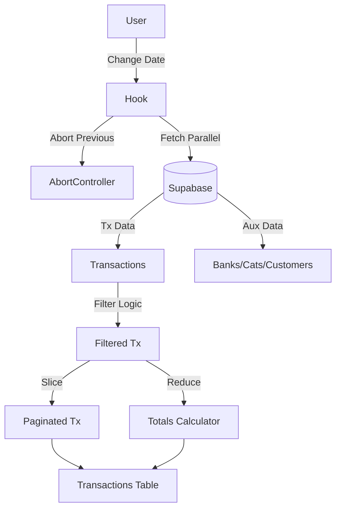

# Alexandria Project: useTransactionsData

> **"O Grande Armazém do Módulo Financeiro."**

---

## 5W2H Matrix: The Essence

| Dimension | Description |
| :--- | :--- |
| **WHO** (Quem) | O "Backend Frontend". Qualquer componente que precise listar, filtrar ou somar transações (como a `TransactionsPage`) consome este hook. |
| **WHAT** (O Que) | Um **Hook de Dados & Estado** gigantesco. Ele busca não apenas as transações, mas todas as entidades relacionadas (Bancos, Clientes, Fornecedores, Categorias) e aplica filtros, busca e paginação *no cliente*. |
| **WHY** (Por Que) | **Experiência Instantânea**. Ao invés de ir ao servidor a cada letra digitada na busca ou mudança de filtro, trazemos um bloco de dados (ex: do mês atual) e filtramos localmente. Isso torna a UI "snappy" (ágil). |
| **WHERE** (Onde) | Arquivo: `src/modules/finance/transactions/hooks/useTransactionsData.ts`.<br>UI: Tabela de Transações. |
| **WHEN** (Quando) | Ao entrar na tela de Transações ou alterar o Filtro de Data/Empresa. |
| **HOW** (Como) | Dispara um `Promise.all` para buscar 6 tabelas diferentes em paralelo. Usa `AbortController` para cancelar requisições antigas se o usuário clicar furiosamente nos filtros. Calcula totais (Entradas/Saídas) iterando sobre o array filtrado. |
| **HOW MUCH** (Quanto) | **Memória**: Médio/Alto. Armazena arrays completos de entidades. <br>**Rede**: ~6 Requests simultâneos no carregamento inicial. |

---

## Seção A: Manual de Operações (User Guide)

### 1. Como Consumir (The Happy Path)
```typescript
const { 
  transactions,        // Lista completa (sem paginação)
  paginatedTransactions, // Lista da página atual (ex: 50 itens)
  totals,              // { entradas: 1000, saidas: 500, saldo: 500 }
  isLoading,           // True enquanto baixa tudo
  setSearchTerm,       // Função para buscar
  filters              // Estado atual dos filtros
} = useTransactionsData();
```

### 2. Filtros & Performance
O hook implementa uma estratégia de **"Fetch once, filter everywhere"** (dentro do range de data):
1.  **Servidor**: Filtra apenas por `company_id` e `dateRange` (ex: 01/Jan a 31/Jan).
2.  **Cliente**: Filtra por Texto, Banco, Categoria, Status, etc.
    *   *Vantagem*: Filtrar por "Banco X" é instantâneo (0ms de latência de rede).
    *   *Limitação*: Se você quiser buscar uma nota fiscal de 3 anos atrás, precisa mudar o `dateRange` primeiro.

### 3. Paginação
A paginação é **Client-Side**.
*   Se o mês tem 500 transações, o hook baixa as 500.
*   Entrega apenas 50 para a Tabela renderizar.
*   Isso evita travar o navegador tentando desenhar 500 linhas de uma vez.

---

## Seção B: A Engenharia Profunda (Technical Docs)

### 1. Race Condition Guard (`AbortController`)
Em aplicações financeiras, a precisão é vital. Se o usuário mudar de "Janeiro" para "Fevereiro" e rapidamente voltar para "Janeiro":
1.  Request JAN (Lento) inicia.
2.  Request FEV (Rápido) inicia e termina.
3.  Request JAN termina e **sobrescreve** FEV.
    *   *Erro*: O usuário vê o título "Fevereiro" mas os dados de "Janeiro".
*   **Solução**: O hook usa `abortControllerRef`. Ao iniciar FEV, ele cancela vigorosamente o request de JAN. "Só existe uma verdade: a última solicitada."

### 2. Derived State & Memoization
O hook faz uso pesado de `useMemo` para evitar recalculations.
*   **`filteredTransactions`**: Só roda se `transactions` ou `filters` mudarem.
*   **`totals`**: Derivado de `filteredTransactions`. Se você filtra por "Banco Inter", os totais no topo da tela recauculam automaticamente para mostrar apenas o saldo *daquele* filtro.

### 3. Safe State Pattern
Usa `useSafeState` (provavelmente um wrapper que checa `isMounted`).
*   Isso previne o erro clássico do React: *"Can't perform a React state update on an unmounted component"*. Se o usuário sair da tela antes do download terminar, o hook engole o resultado silenciosamente.

---

## Seção C: Arquitetura e Fluxo


